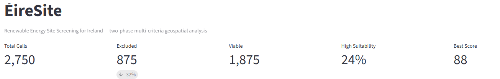
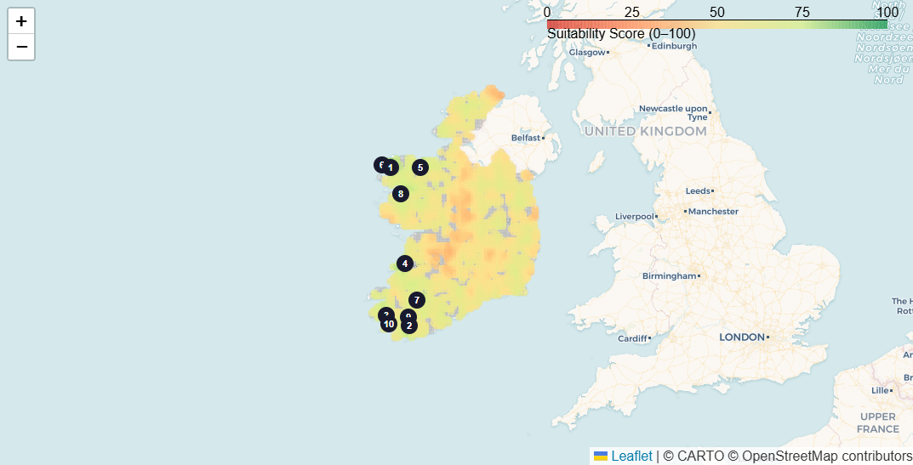
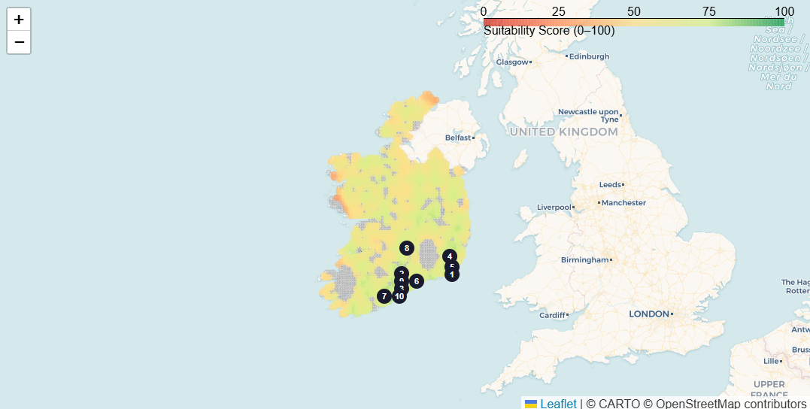
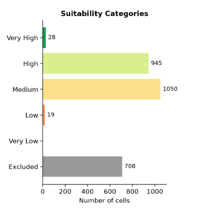
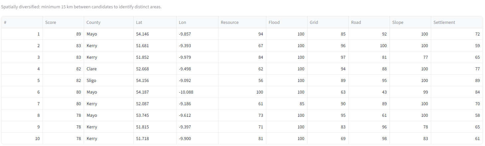

# ÉireSite

[Live Demo](https://eiresite.streamlit.app/)

**Renewable Energy Site Screening for Ireland**

A two-phase multi-criteria geospatial analysis tool that identifies optimal locations for wind and solar energy projects across the Republic of Ireland.



---

## Overview

ÉireSite applies GIS-based Multi-Criteria Decision Analysis (GIS-MCDA) to screen Ireland's landscape for renewable energy suitability. The tool divides the country into a grid and evaluates each cell through two phases:

1. **Hard constraint screening** eliminates unsuitable areas (protected sites, flood zones, steep terrain, settlement buffers)
2. **Weighted scoring** ranks remaining cells across five criteria with user-adjustable weights

The interactive dashboard lets users switch between **Wind Farm** and **Solar PV** assessments, adjust criterion weights in real time, and explore spatially diversified top-10 candidate zones.

---

## Wind Farm Assessment



Top candidates concentrate along Ireland's western seaboard — Mayo, Kerry, Clare, and Sligo — where mean wind speeds at 100m are highest and grid infrastructure from existing wind farms is accessible.

## Solar PV Assessment



Solar suitability shifts toward the south and southeast, reflecting higher Global Horizontal Irradiance values. Top zones appear in Kerry, Wexford, and Waterford with gentler terrain and good road access.

---

## Score Distribution



Viable cells are classified into five bands: Very Low (0-20), Low (20-40), Medium (40-60), High (60-80), and Very High (80-100).

---

## Top 10 Candidate Zones



Candidates are **spatially diversified** with a minimum 15 km separation to ensure geographic spread rather than clustering in a single high-scoring pocket.

---

## Methodology

### Phase 1 — Hard Constraint Screening

Cells that fail any of these checks are eliminated before scoring:

| Constraint | Rule | Rationale |
|---|---|---|
| Protected Areas | SAC/SPA overlap | EU Habitats & Birds Directives |
| Flood Risk | High-probability flood zone | OPW NIFM classification |
| Slope | Solar: >15° / Wind: >30° | Energy-type maximum threshold |
| Settlement Proximity | Solar: <500m / Wind: <1500m | Minimum buffer distance |

### Phase 2 — Weighted Multi-Criteria Scoring (0-100)

Viable cells are scored across five criteria. Users can adjust weights to reflect project priorities.

| Criterion | Method | Source |
|---|---|---|
| Resource Potential | Wind: mean speed at 100m; Solar: GHI | Global Wind Atlas / PVGIS |
| Grid Proximity | Distance to nearest substation/wind farm (cKDTree) | SEAI Wind Farms dataset |
| Road Access | Distance to nearest road (line sampling + cKDTree) | OSi National 250k roads |
| Terrain Slope | Pre-computed slope grid, scored by ideal range | Derived from DEM |
| Settlement Buffer | Distance beyond minimum exclusion zone | OSM populated places |

**Score combination:** Weighted linear combination with user-defined weights, normalised to sum to 1.

**Default weights:** Resource 30% · Grid Distance 25% · Road Access 15% · Slope 15% · Settlement Distance 15%

---

## Sensitivity Analysis

Each weight is increased by 50% (others re-normalised) to measure how the top-10 ranking responds:

| Criterion | Perturbed Weight | Top-10 Stability |
|---|---|---|
| Resource | 45 | 80% |
| Grid Distance | 37 | 80% |
| Road Distance | 22 | 80% |
| Slope | 22 | 80% |
| Settlement Distance | 22 | 90% |

80-90% stability indicates a robust ranking that doesn't flip dramatically when priorities shift.

---

## Data Sources

| Dataset | Provider | Format | Licence |
|---|---|---|---|
| [NIFM River Flood Extents](https://data.gov.ie/dataset/nifm-river-flood-extents-current-scenario) | OPW | Shapefile (ITM) | CC BY-NC-ND 4.0 |
| [Special Areas of Conservation](https://npws.ie/node/11948) | NPWS | Shapefile (ITM) | Government of Ireland |
| [Special Protection Areas](https://npws.ie/node/11948) | NPWS | Shapefile (ITM) | Government of Ireland |
| [Natural Heritage Areas](https://npws.ie/node/11948) | NPWS | Shapefile (ITM) | Government of Ireland |
| [Global Wind Atlas — 100m](https://globalwindatlas.info/) | DTU / World Bank | GeoTIFF / API | CC BY 4.0 |
| [PVGIS — GHI](https://re.jrc.ec.europa.eu/pvg_tools/en/) | EU Joint Research Centre | API / CSV | Open (EU JRC) |
| [Wind Farms in Ireland](https://data.gov.ie/dataset/wind-farms-in-ireland) | SEAI | Shapefile (ITM) | CC BY 4.0 |
| [Roads — National 250k](https://data.gov.ie/dataset/roads-national-250k-map-of-ireland1) | Tailte Eireann / OSi | Shapefile | CC BY 4.0 |
| [SRTM DEM](https://e4ftl01.cr.usgs.gov/MEASURES/SRTMGL1.003/) | NASA / USGS | HGT (raster) | Public Domain |
| [OpenStreetMap — Populated Places](https://www.openstreetmap.org/) | OSM contributors | Overpass API | ODbL |

---

## Tech Stack

- **Python** — GeoPandas, Shapely, SciPy, NumPy, Pandas
- **Streamlit** — Interactive dashboard framework
- **Folium / Leaflet** — Map rendering with CARTO basemap tiles
- **Matplotlib** — Score distribution charts
- **CRS:** EPSG:2157 (Irish Transverse Mercator) for analysis, EPSG:4326 for display

---

## Getting Started

### Prerequisites

- Python 3.10+

### Installation

```bash
git clone https://github.com/kaan36875/eiresite.git
cd eiresite
pip install -r requirements.txt
```

### Run

```bash
streamlit run app.py
```

The app launches in demo mode with synthetic data by default. To use real datasets, place shapefiles in `data/raw/` following the structure expected by `src/data_loader.py`.

### Environment Variables

| Variable | Description |
|---|---|
| `CARTO_API_KEY` | CARTO Basemaps API key for map tiles (optional — falls back to default tiles) |

---

## Known Limitations

- **Demo data:** Default mode uses synthetic data for demonstration. Real datasets should be downloaded for production use.
- **Republic of Ireland only:** Covers the 26-county Republic. Northern Ireland (UK jurisdiction) is excluded.
- **Peatland/bog risk:** Not yet included as a constraint. Relevant for wind projects in western Ireland.
- **Grid capacity:** Grid proximity uses existing wind farms as a proxy; actual substation capacity is not modelled.
- **Visual impact:** Cumulative visual impact is not modelled. Planning authorities may refuse projects near existing turbine clusters.
- **Resolution:** Analysis grid cells (2-10 km) are coarse for final site selection. This tool identifies candidate zones for detailed study.

---

## Project Structure

```
eiresite/
├── app.py                  # Streamlit dashboard
├── config.py               # CRS, weights, energy type parameters, data sources
├── requirements.txt
├── data/
│   └── roi_boundary.geojson
└── src/
    ├── analysis.py         # Phase 1 exclusion + Phase 2 scoring engine
    ├── counties.py         # Reverse geocoding via county centroids
    ├── data_loader.py      # Real/demo data switching
    └── demo_data.py        # Synthetic data generation
```

---

## Licence

This project is for educational and portfolio purposes.
